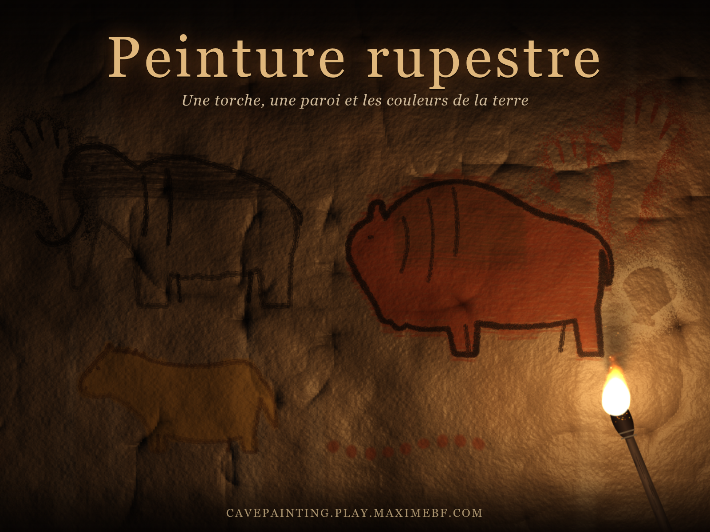

# Cave Painting

Paint like an Upper Palaeolithic artist on a torch-lit cave wall.



**Play:** https://cavepainting.play.maximebf.com

A procedurally generated limestone wall, lit only by a flickering torch you can drag around. Paint with period tools and earth pigments, blow pigment around your hand to make stencils, or trace an animal from a sheet of tracing paper. The game is in French and works offline once installed as an app (iPad first, desktop and phones too).

## Features

- **Tools:** finger, pigment lump, fur brush and chewed twig, each with its own mark. Pen pressure widens strokes.
- **Pigments:** red, burnt and yellow ochre, umber, manganese black, charcoal and white kaolin. No modern colours.
- **Blowpipe stencils:** hold a hand, leaf or seashell against the rock and blow pigment around it. The longer you press, the wider the halo.
- **Tracing paper:** mammoth, tiger, bison and horse outlines to trace over. The paper is never part of the painting.
- **Atmosphere:** raking torch light over the rock relief, and synthesised sound (fire, drips, cave drone, breath) in a long cave reverb.
- Undo / redo, autosave, save a picture (PNG), export / import the painting (JSON), fresh wall, left-handed layout, calmer flame.

See [SPEC.md](SPEC.md) for the full game design.

## Development

Requires Node.js.

```sh
npm install
npm run dev        # dev server, reachable on the LAN for iPad testing
npm test           # Vitest unit tests for the rules engine
npm run test:e2e   # Playwright smoke tests (builds first)
npm run build      # production build into dist/
```

Debug URL flags: `?seed=N` (wall seed), `?fresh` (ignore the saved painting), `?debug` (exposes `window.cave`).

Other scripts: `npm run icons` (app icons), `npm run poster` (renders `marketing/poster.png` from the game), `npm run deploy` (build, then deploy to a Cloudflare Worker with `cf`; needs `CLOUDFLARE_ACCOUNT_ID` and `CLOUDFLARE_API_TOKEN` in `.env`).

## How it works

Vite + TypeScript, with Phaser 3 for the board and plain DOM for the menus.

- `src/sim/`: the rules engine. Plain, deterministic TypeScript at a fixed 10 ticks/s with seeded randomness, so a painting is stored as a list of actions and replayed exactly.
- `src/render/`: Phaser scene, lighting shader, procedural rock and textures. It only draws what the sim reports.
- `src/units.ts`: all tuning numbers, tools, pigments and stencils as data.
- `src/content/`: player-facing text (`lines.json`) and animal outlines.
- `src/audio/`: synthesised sound through one AudioContext.
- Offline-first PWA without Workbox: the loading screen fills the cache, only when running as the installed app.

See [TECH_SPEC.md](TECH_SPEC.md) for the stack and platform details and [AGENTS.md](AGENTS.md) for contributor notes.
